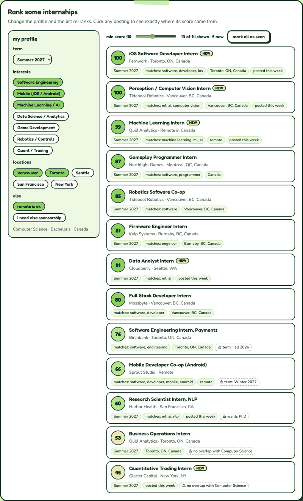

# InternScout

**A Mac app that finds internships and co-ops that fit you, and helps you keep track of
every application.**

Tell InternScout your university, degree level, year of study, major, interests and where
you want to work. It downloads thousands of live postings from internship lists and
company job boards, scores each one against your profile, hides the ones you are not
eligible for, and tells you what is new since you last looked. Once you apply, it keeps
a record of each application and how it went (online assessment, interview, offer or
rejection) and charts your results.

Everything runs on your Mac. Your profile and application history are never uploaded
anywhere; the app only downloads public job postings.

Written in C++17 with SDL2, OpenGL and Dear ImGui for the window. A command-line version
(`internscout`) is built alongside the app and shares the same profile and data.

## Demo



Recorded from the macOS app itself with a made-up profile, ranking real postings from the job feeds. There's also a browser version on my portfolio: [try it here](https://nicole-li7.github.io/projects/internscout.html).

## What's new

**October 2026: faster, no more freezing.**

- **Re-ranking is about 80x faster** (around 40 s down to about half a second for 15,000
  postings) and no longer freezes the window. The eligibility checks (citizenship,
  sponsorship, graduation year, year of study) now read each description once when it's
  downloaded and save the result with the listing, instead of re-reading every posting
  each time you change your profile.
- **Ranking happens in the background**: at startup, after a refresh and after saving your
  profile. The status line says *Ranking...* while it works, and the table stays usable.
- **Auto-refresh now defaults to every 2 hours** (it was 30 minutes). A deep search checks
  about 2,400 job boards, and refreshing too often gets the app rate-limited by them.
- **Smarter downloading**: connections are reused between job boards. A board that sends
  nothing for 15 seconds is skipped, while a big one that is still downloading gets up to
  30. Only rate-limit and server errors are retried.
- **Timings**: the status line (and the command line, in `[time]` lines) shows how long
  each step took: downloading, finding boards, merging duplicates, ranking, filtering
  and loading/saving the cache.

The scores and the eligibility results are exactly the same as before. The first launch
after updating takes a few extra seconds while it converts the saved listings.

## Contents

- [Demo](#demo)
- [What's new](#whats-new)
- [Features at a glance](#features-at-a-glance)
- [Getting started](#getting-started)
- [Using the app](#using-the-app)
- [Tracking your applications](#tracking-your-applications)
- [Where the listings come from](#where-the-listings-come-from)
- [How matching works](#how-matching-works)
- [Hidden as not eligible](#hidden-as-not-eligible)
- [The command line](#the-command-line)
- [Your data](#your-data)
- [Building from source](#building-from-source)
- [Project layout](#project-layout)

---

## Features at a glance

- **Live postings from many sources**: two community internship lists plus direct
  searches of about 2,400 company job boards (Workday, Greenhouse, Ashby, Lever,
  SmartRecruiters, Workable). That's about 15,000 listings from 1,700 companies.
- **Ranked for you**: every posting gets a score out of 100, with the reasons shown,
  so you can see why it ranks where it does.
- **Eligibility filter**: postings that require citizenship, refuse sponsorship you need,
  or are for a degree level, graduation year or year of study you don't have are hidden.
- **NEW badges and notifications**: leave the app open and it re-checks on a timer,
  sending a macOS notification when a good new match appears.
- **Saved and Applied lists that never lose anything**: every bookmarked or applied
  posting is copied into your own data, so it stays even after the company takes it down.
- **Application tracking**: tick OA, Interviewed, Offer or Rejected on each application
  and see your interview, offer and rejection rates on a chart.
- **Command-line version** for searching from the terminal or running in the background.

---

## Getting started

1. **Install**: build and install it (see [Building from source](#building-from-source)).
   This puts `InternScout.app` in `/Applications` and the `internscout` command in
   `/opt/homebrew/bin`.
2. **Open InternScout.** The first time, you land on **My profile**.
3. **Fill in your profile** and press **Save and find internships**. The app downloads
   listings in the background. A deep search takes a minute or two, and the table fills
   in when it finishes.
4. **Browse the Internships tab**, open the ones you like, and press **Save** or
   **Mark applied** as you go.

Listings are cached for 6 hours, so reopening the app is instant. Press **Refresh now**
any time to re-download.

---

## Using the app

The window has five tabs.

### My profile

- **Dropdowns** for university, major, degree level (Bachelor's / Master's / PhD), year of
  study, expected graduation year and home country. Pick *Other* to type your own.
- **Interests**: a grid of checkboxes (Software Engineering, Machine Learning / AI, Data
  Science / Analytics, ...) or *Any / all fields*. Each interest expands into several search words
  behind the scenes ("Machine Learning / AI" also matches ml, ai, deep learning, ...).
  You can add your own interest too.
- **Preferred locations**: a grid of cities, or *Anywhere*. You can add your own city.
  Tick whether remote work is fine.
- **Visa sponsorship**: tick it if you would need US sponsorship. Postings that refuse
  it are then marked not eligible.
- **Terms**: which terms you want (e.g. Summer 2027). Postings explicitly for other
  terms are hidden unless you tick *All terms*.

Your answers are only used to rank listings.

### Internships

Every matching posting, best match first.

| Column | What it shows |
|---|---|
| Score | 0-100: green 70+ (strong match), amber 45-69 (worth a look), grey below 45 |
| Badge | **NEW** (appeared since you last looked), **SAVED**, **APPLIED** / outcome, or **NOT ELIG.** |
| Company / Role / Location | Location shows the first city and how many more; closed postings say *(closed)* |
| Posted | When the posting went up |

Click a row to see its details below the table: full location list, term, degrees,
category, sponsorship notes, source, the description, and **the reasons behind its
score**. Double-click a row (or press **Open & apply**) to open the posting in your browser.

**Toolbar:**

| Control | What it does |
|---|---|
| Refresh now | Re-download all listings now |
| Auto-refresh | Off / every 15 min / 30 min / hour / 2 hours (the default), with a notification for good new matches |
| Deep search | On: also search every company board linked from the lists (slower, finds far more). Off: lists only (seconds) |
| Search box | Filter by company, title or city |
| Min score | Hide listings below this score (default 40) |
| Type | Internships & co-ops, internships only, or co-ops only |
| All terms | Also show postings for terms you didn't pick |
| Hide ineligible | Hide postings with a requirement you don't meet (on by default) |

### Saved

Postings you bookmarked with **Save**. Pressing **Mark applied** moves one to Applied.

### Applied

Every posting you've marked as applied. Here you track how each application went; see
the next section.

### Explanation

How the score is calculated, what gets hidden as not eligible, where the listings come
from, and how your data is stored, all inside the app.

---

## Tracking your applications

Select any job on the **Applied** tab. Under its buttons there's a **What happened?** row:

- ☐ **Got an online assessment**
- ☐ **Interviewed**
- ☐ **Offer**
- ☐ **Rejected**

Tick as many as apply. An application often goes OA → interview → offer or rejection.
Changes save immediately.

The badge column shows the furthest step each application has reached, in its own colour:

| Badge | Meaning |
|---|---|
| **OFFER!** | You got an offer |
| **REJECTED** | It ended in a rejection |
| **INTERVIEW** | You interviewed |
| **OA** | You got an online assessment |
| **APPLIED** | Nothing yet |

### The chart

Switch the Applied tab from **List** to **Chart** to see:

- **Your totals**: how many applications, with your OA, interview, offer and rejection
  rates as a percentage of everything you applied to.
- **What happened to your applications**: one bar each for Online assessment,
  Interviewed, Offer, Rejected and No response yet, with the count and percentage.
  An application can count in more than one bar (an OA and then a rejection, say).
- **Interviews vs rejections**: a single bar split between the two, with the
  percentages and a ratio such as "about 1 interview for every 4.0 rejections".

Hover any bar for the exact numbers. The colours (gold, blue, teal, burnt orange) were
chosen so they stay distinguishable with colour blindness, and every bar is also
labelled with its numbers.

Outcomes follow a posting even if its ID changes or it closes. If you press **Not applied**
by mistake, the outcomes you ticked are kept and come back when you mark it applied again.

---

## Where the listings come from

Nothing is scraped from web pages. Every source is a public data feed or a job board's own
public API.

| Source | What it is |
|---|---|
| **Simplify** internship list | A community-maintained list of tech internships on GitHub (~4,000 active postings, updated daily), with term, location, degree and sponsorship details |
| **Community list** | A second, smaller GitHub internship list in the same format |
| **Company job boards** | Direct queries to the systems companies host their careers pages on: Workday, Greenhouse, Ashby, Lever, SmartRecruiters and Workable |

With **Deep search** on (the default), InternScout reads every link in the internship
lists, works out which company job board each one points at (about 2,400 boards) and queries
each board directly. That picks up every internship and co-op those companies have posted,
including small companies and roles nobody submitted to the lists.

| | Quick (lists only) | Deep search |
|---|---|---|
| Listings | about 4,000 | about 15,000 |
| Companies | about 800 | about 1,700 |
| Refresh time | a few seconds | 2-3 minutes, in the background |

Only internship and co-op titles are kept from company boards. The same job often appears in
a list *and* on the company's board; duplicates are merged and the board version is kept
because it has the full description. Boards without a public API (e.g. iCIMS, Oracle) can't
be searched, so those postings only appear if a list includes them.

Extra boards can be added by hand in `sources.json` in the data folder (run
`internscout sources` to see the path).

---

## How matching works

Each listing gets a score out of 100 (signals are added up, then clamped to 0-100):

| Signal | Points | How it's decided |
|---|---|---|
| Term | 25 / 12 / 0 | 25 if the term matches one you picked, 12 if the posting doesn't say, 0 if it's for another term |
| Relevance | up to 40 | Interest words in the title or category (+14 each) or only in the description (+6); your major adds more |
| Location | 20 / 14 / 12 / 10 / 0 | A city you chose / remote and you're fine with it / you chose Anywhere / in your home country |
| Degree level | +10 / +6 / -15 | Lists your level / doesn't say / lists other levels only (e.g. PhD-only) |
| Freshness | 10 / 6 / 2 / 0 | Posted within 7 days / 30 days / 90 days / older |
| Sponsorship | -30 / +5 | Only if you need sponsorship: refuses it or requires citizenship / says it sponsors |

There's also +4 if the description mentions your graduation year, and a "Watch out" note
(no point change) if it asks for a rising senior and you're in an earlier year.

Several listings often tie at 100; ties are ordered newest first. Every listing shows the
reasons for its score, so nothing is a black box.

---

## Hidden as not eligible

Some requirements aren't about fit; they rule you out completely. When a posting states
one of these and your profile doesn't meet it, it's hidden (untick **Hide ineligible** in the
app, or pass `--all` on the command line, to see it marked **NOT ELIG.** with the reason):

- **Citizenship** of another country or a **security clearance** ("must be a U.S. citizen")
- **No visa sponsorship**, if you said you need it ("will not sponsor")
- A **graduation window** you fall outside of ("graduating by June 2028")
- A **degree level** you don't have (Master's or PhD only)
- A **year of study** you haven't reached ("rising seniors", "current juniors or seniors")

The internship lists carry citizenship, sponsorship and degree data directly. The other
checks read the posting's description, which only company job boards provide. Wording varies,
so an unusually phrased requirement can slip through. Always double-check the posting itself.

---

## The command line

The `internscout` command uses the same profile, listings and saved/applied data as the app.

```
$ internscout search

Top internships for Nicole (Summer 2027)
----------------------------------------
3 new since your last check

1.  100  NEW      Apera AI     Machine Learning Applied Scientist Co-op   Vancouver, BC, Canada  2026-09-15
         Summer 2027 | matches: machine learning | Vancouver, BC, Canada | posted this week
2.  100  SAVED    Robinhood    iOS Software Developer Intern              Toronto, ON, Canada    2026-09-14
         Summer 2027 | matches: software | Toronto, ON, Canada | posted this week
...
```

### Commands

```sh
internscout setup            # answer a few questions (year, major, interests, locations, term)
internscout search           # fetch listings and show the best matches
internscout show 3           # full details for result 3 from the last search
internscout open 3           # open result 3 in your browser to apply
internscout save 3           # bookmark it          (unsave 3 to remove)
internscout applied 3        # mark it as applied
internscout saved            # list bookmarks and applications
internscout profile          # print your profile
internscout watch            # keep checking every 30 min; macOS notification on new matches
internscout sources          # what is being searched; `sources deep on|off` to switch modes
internscout help             # all commands and options
```

### Options

```
--refresh, -r       re-download listings (otherwise a 6-hour cache is used)
--all, -a           include weak matches, other terms and listings you are not eligible for
--limit N, -n N     how many results to show (default 25)
--min N, -m N       minimum score 0-100 (default 40)
--every N, -e N     minutes between checks in watch mode (default 30)
--type intern|coop  show only internships, or only co-ops
```

Application outcomes (OA / interview / offer / rejected) are set in the app; the command
line keeps them intact.

---

## Your data

Everything is stored locally in `~/Library/Application Support/InternScout/`:

| File | What's in it |
|---|---|
| `profile.json` | Your profile answers |
| `sources.json` | Which job boards to check, and whether deep search is on |
| `listings.json` | Cached postings from the last download (refreshed after 6 hours) |
| `state.json` | What you've seen, saved and applied to, a private copy of each saved/applied posting, and your application outcomes |

- **Nothing about you is sent anywhere.** The app only downloads public job listings.
- **Saved and applied postings are never lost.** Each one is copied into `state.json`, so
  it stays on the Saved / Applied tabs after the posting closes or the listings are
  re-downloaded. A posting that has disappeared from every source is shown as *(closed)*.
- **`state.json` is written safely.** It's written to a temporary file and then swapped in,
  so a crash mid-save can't leave a half-written file.
- **Backing up** is just copying that folder somewhere safe.

---

## Building from source

You need:

- macOS with the Xcode command line tools (`xcode-select --install`)
- CMake and SDL2: `brew install cmake sdl2`
- libcurl and OpenGL, which ship with macOS

```sh
cmake -S . -B build
cmake --build build
cmake --install build        # InternScout.app -> /Applications, `internscout` -> /opt/homebrew/bin
```

Or open the folder in VS Code and press **Cmd+Shift+B**. The built app is at
`build/InternScout.app` and is self-contained (SDL is copied into the bundle by
`tools/bundle_libs.sh`), so it can be copied to another Mac.

After installing a new version, quit InternScout (⌘Q) and reopen it.

---

## Project layout

```
src/gui/main_gui.cpp  window, OpenGL and event loop (SDL2 + Dear ImGui)
src/gui/app.*         the app: tabs, profile form, results table, detail panel,
                      application outcomes and chart, background refresh
src/options.*         dropdown / checkbox choices and how they expand into search words
src/main.cpp          command-line interface
src/profile.*         profile questions + JSON save/load
src/sources.*         fetchers for each internship list and job board
src/matcher.*         scoring a listing against a profile
src/eligibility.*     hard requirements that hide a listing (citizenship, sponsorship,
                      graduation, degree, year)
src/store.*           listings cache and saved/applied/outcome state
src/http.*            libcurl wrapper
src/text.*            string helpers
src/timing.*          step timings shown in the status line and printed by the CLI
src/ui.*              terminal colours, tables, notifications
third_party/          nlohmann/json (single header), Dear ImGui
tools/                app icon generator, bundle script
```
